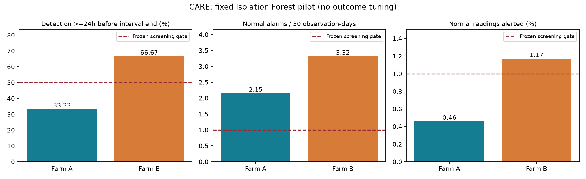

# CARE basic model: results and dataset decision

28 October 2026. Related GitHub issue #21. Protocol:
[care-baseline-protocol.md](care-baseline-protocol.md).

**Decision: retain CARE as a research candidate, but do not adopt this baseline
as the project's warning model. Useful predictive maintenance is not established.**
The fixed model detects some labelled degradation, especially in Farm B, but
neither farm passes the predeclared detection/false-alarm screening rule. Rejecting
the entire dataset from one generic model would be stronger than the evidence.
The earlier EDA verdict established structural suitability, not model success.

## Actual training and evaluation

Trained 37 independent Isolation Forests: one per event file, using only that
file's earlier normal history. Evaluated all 22 Farm A files and 15 Farm B files.
The model sees sensor averages only. Training/calibration status selection is
retrospective benchmark curation; prediction status and event labels are excluded.
There is no pooled model and no random row split. This is known-history adaptation,
not a test of zero-shot transfer to new turbines.

Each training period was split chronologically 80/20 into fitting/calibration.
The fitted model uses up to 12,000 fitting rows, 100 trees and a fixed seed.
Calibration sets the 99th-percentile anomaly threshold. Six consecutive above-
threshold readings trigger an alert; missing cadence or a non-exceedance resets
the sequence. All prediction rows met the input-validity rule. No thresholds or
model parameters were changed after examining outcomes. Run time: 90.3 seconds,
including loading, source hashing and saving local model/score artifacts.

| Measure | Farm A | Farm B | Required screening level |
|---|---:|---:|---:|
| Anomaly cases detected >=24h before annotated end | 4/12 (33.3%) | 4/6 (66.7%) | >=50% |
| Any within-interval detection | 4/12 | 4/6 | Descriptive |
| Normal alarm episodes | 13 | 26 | Descriptive |
| Normal observation-days | 181.0 | 234.85 | Exposure denominator |
| Normal alarm episodes / 30 observation-days | 2.15 | 3.32 | <=1 |
| Normal readings in alert state | 0.46% | 1.17% | <=1% |
| Normal files with alerts | 4/10 | 2/9 | Descriptive |
| Overall screening gate | **Fail** | **Fail** | All conditions |

The no-alarm reference detects 0/12 and 0/6 cases and produces zero alarms.
The model adds detections at a measurable alarm cost; improvement over that
reference alone is not sufficient. These normal files are curated benchmark
controls, so the rates are not estimates of an operating fleet's false-alarm rate.
Observation-days count available 10-minute rows; gaps are not counted as exposure.



## What the detected cases mean

Farm A detections: events 0, 40, 45 and 73, spanning three turbines. Their first
in-interval alerts precede the annotated ends by 155–297 hours. Farm B detections:
19, 27, 53 and 77, across four turbines, with 221–996 hours to annotated ends.
None was an alert already active before the anomaly interval began.

These numbers are **time to the annotation's end, not independently verified
time to physical failure**. They must not be presented as demonstrated days of
advance failure prediction. Long anomaly intervals make this distinction material.

A post-result status audit (interpretation only; no scoring changes) found first
alerts in B events 19/27 occurred in status 0 (normal production), and 53/77 in
status 1 (derated operation). Thus the four B first alerts are not labelled
downtime-only detections. This still does not establish a causal precursor.
All four A alerts carry status 4, but A's fault-derived status windows cannot
independently establish that the turbine was stopped. The publisher explicitly
warns about A's status interpretation in prediction evaluation.
[Publisher notes](https://zenodo.org/records/15846963).

The alarm burden is concentrated: Farm B turbine 2 accounts for 22 of 26 normal
alarm episodes, and turbine 11 for four. This warrants an operating-regime/shift
investigation; it does not authorize deleting those controls or retrospectively
adjusting the threshold. A produces normal alarms on four of its five turbines.

## Practical recommendation

- **Keep the data; reject this configuration.** There is enough detection evidence
  to justify one bounded, condition-aware comparison rather than discarding CARE.
- Do not replace the existing project model or claim predictive viability from
  these results. If a working baseline is required immediately, CARE has not yet
  earned adoption under the stated gate.
- A next experiment should model temperature relative to wind, power and ambient
  conditions, with a fixed residual/persistence policy. Freeze its settings before
  evaluation. Farms A/B are now development-exposed; repeated experiments on them
  cannot be described as independent confirmation.
- Farm C remains performance-uninspected, although its metadata/quality were
  inspected in EDA. Reserve grouped C cases for a later frozen confirmation plan;
  do not spend its test outcomes on open-ended tuning.
- Resolve the physical failure endpoint and agreed actionability requirement
  before asserting advance fault warning. Keep wind-turbine scope distinct from
  generalization to hydro plants or all renewable equipment.

This is a basic feasibility screen, not proof of absence of predictive information,
a complete CARE-score benchmark, or a deployment validation. Repeated event files
from the same turbine are correlated. Models are fitted independently, preventing
cross-file training contamination, but this does not make their results independent.
Per-turbine summaries are supplied; no misleading independent-file confidence
interval is reported.

## Evidence and checks

- [Training script](../scripts/train_care_baseline.py),
  [report script](../scripts/report_care_baseline.py),
  [tests](../tests/test_care_baseline.py).
- [Aggregate summary](results/care-baseline-v1/summary.json),
  [all 37 cases](results/care-baseline-v1/events.csv),
  [turbine summaries](results/care-baseline-v1/turbines.csv),
  [configuration and protocol hash](results/care-baseline-v1/config.json).
- Source file and fitted-model SHA-256 hashes are in the per-case records.
  Models and timestamp scores remain ignored in `.local/care-baseline-v1-models`.
- Three tests passed: gap/reset behavior, prefix-invariant persistence, and
  invariance of fitted threshold/earlier scores when future prediction values and
  prediction status change. All 37 fitting/calibration/prediction boundaries
  were verified; Ruff passed. The result chart was visually inspected.

Reproduce into **new** output directories (the runner refuses existing paths):

```powershell
.venv/Scripts/python.exe scripts/train_care_baseline.py --output docs/results/care-baseline-reproduction --models .local/care-baseline-reproduction-models
```

The source data and existing application/model configuration were left unchanged.
