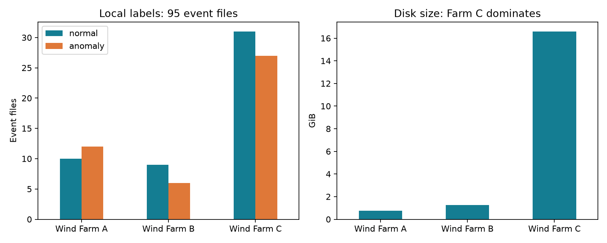

# CARE To Compare: dataset suitability assessment

28 October 2026. Related tracking: GitHub #21 (independent evaluation), #7
(documentation/scope); this assessment does not supersede SHP tasks #19–20.

**Verdict: suitable for a controlled wind-turbine early-warning research prototype.
Proceed to a small, frozen baseline experiment. Predictive usefulness is not yet
demonstrated, and switching the project's primary dataset remains a scope decision.**

It fits the preferred title, *A Machine Learning–Based Early Fault Warning System
for Renewable Energy Equipment*. Results on these turbines would support a wind
case study, not validated generalization to hydroelectric equipment or all renewables.

## What was actually inspected

The source folder was opened read-only. No dataset copies, model training or
changes to existing application/data configuration were made. A single sequential
pass read all 95 files, selecting metadata and average sensor channels in 4,096-row
chunks using float32 measurements. The scan took 291 seconds. CSV parsing still
reads the source bytes; column selection reduces memory and numerical processing,
not the underlying disk scan. Peak RAM was not measured. Timestamp sets are held
for one file at a time; measurements for the full collection are never concatenated.

| Farm | Files | Turbines | Anomaly / normal | Rows | Disk GiB | Average channels |
|---|---:|---:|---:|---:|---:|---:|
| A | 22 | 5 | 12 / 10 | 1,196,747 | 0.748 | 46 |
| B | 15 | 9 | 6 / 9 | 859,065 | 1.272 | 63 |
| C | 58 | 22 | 27 / 31 | 3,187,136 | 16.595 | 238 |

Total: **5,242,948 rows, 36 farm-qualified turbines, 45 anomaly files and
50 normal files**, occupying 19,987,435,435 bytes. Rows are file observations,
not verified unique physical observations across event files. The 86/257/957
column counts include metadata and non-average statistics.



## Quality and label findings

- No duplicate timestamps within any file. Cross-file duplication of physical
  history was not tested; event files from the same turbine are not independent.
- There are 460, 87 and 40 adjacent intervals other than 600 seconds in A, B
  and C respectively. These are irregular interval counts, not missing-row counts.
  Feature windows must explicitly handle cadence breaks.
- Missing/nonfinite average-channel cells: A 0.0000727%, B 0%, C 0.0057902%.
  C event 36 is the main concentration, at 0.3328% of its average-channel cells.
  Low missingness does not establish physical plausibility or absence of sentinels.
- Constant average channels occur in 42 of C's 58 files; none in A or B.
  Drop constants and fit imputation/scaling using fitting data only.
- Every file's training timestamp range precedes its prediction range. All
  event boundaries fall within the prediction range. This is a boundary check,
  not proof that different files are chronologically independent.
- Anomaly intervals span approximately 1.70–65.51 days (median 13.99 days).
  These are labelled intervals, not measured warning lead times.
- The local README's 44/51 label count is stale relative to the actual 45/50
  event metadata. Exact archive version is **unverified**; metadata hashes are
  retained, but no source archive checksum was available in this inspection.

## Publisher context and implications

The publisher describes this as an early-fault-detection benchmark and reports
corrections across versions. In particular, event 51 changed to anomaly in v5;
v6 adjusted metadata. The publisher warns about implausible min/max/std channels,
especially in B; average channels are the recommended starting point. The
dataset's stated license is CC BY-SA 4.0; retain attribution and review terms
before redistributing derived data. [Dataset and version notes](https://zenodo.org/records/15846963).

The paper describes retrospectively determined anomaly starts, with greater
uncertainty for A. A's status labels incorporate fault-log windows; they are
not independent online failure predictors. [Original paper](https://www.mdpi.com/2306-5729/9/12/138).

Consequently, exclude status, timestamps, IDs, train/test flags and event labels
from predictive inputs. Use status only where justified for normal fitting-data
selection. Do not suppress A's anomalous prediction rows using its fault-derived
status. Report detection relative to the annotated interval; do not present
event_end as an independently verified physical failure time without confirmation.

## Efficient experiment to run next

1. Start with Farm A for pipeline development: only 0.75 GiB and 46 average
   channels. Use B as a second farm-specific experiment; its six anomaly cases
   give limited statistical precision. C dominates disk usage and can wait until
   the pipeline is fixed. No raw-data migration is needed for this decision.
2. Freeze farm-qualified turbine groups before examining detection outcomes.
   Keep all files of a turbine in one development/confirmation group. Do not
   randomly split rows or assume anonymized dates order events across files.
   Audit repeated histories before any pooling. This EDA inspected quality and
   metadata across all farms; future confirmation is performance-uninspected,
   not entirely data-unseen.
3. Separate two claims: normal-history adaptation to a known turbine (using that
   file's supplied training period) and transfer to an unseen turbine. State
   which is evaluated; the former is not zero-shot transfer.
4. Select a small set of described temperature, wind, power and rotational
   channels from each farm's dictionary. Sensor numbers are not interchangeable
   across farms. Check angle/counter semantics, sentinel values and load regimes
   before interpreting trends. Use averages initially; fit all transformations
   only on allowed training observations.
5. Establish a simple normal-trained reference (for example, operating-condition
   residual monitoring) before deep learning. Use chronological fitting and
   calibration segments within training history, causal rolling summaries, and
   fixed persistence/threshold rules. Purge history overlap across boundaries.
   Do not interpolate through outages or tune on prediction outcomes.
6. Report event detection, time to first persistent alert, fraction of the anomaly
   interval covered, normal-period alarm episodes per observed turbine-day, and
   eligibility/coverage. Include all missed/ineligible cases and uncertainty by
   turbine. Compare a constant/no-alarm baseline; row accuracy is inadequate.
7. Freeze a practical warning-time requirement and event-time interpretation
   before claiming advance warning. If a physical failure endpoint cannot be
   verified, describe the result as early detection of annotated degradation.

**Decision gate:** retain CARE for the primary experiment only if a frozen pilot
shows useful event detection at an agreed normal-period alarm burden and the
wind-turbine scope is accepted. This EDA establishes data suitability, not that
such a model already succeeds. No RUL target is justified here.

## Reproduction and limits

Run from the repository root:

```powershell
.venv/Scripts/python.exe scripts/assess_care_dataset.py 'C:\Users\tmuny\Downloads\CARE_To_Compare\CARE_To_Compare' --output .local/care-eda-2026-10-28
```

Aggregate evidence is in `docs/results/care-eda-2026-10-28/`: per-file inventory,
per-feature missingness/constants, summary, run metadata and overview chart.
No raw rows are included. Source metadata SHA-256 hashes are in `run.json`;
full measurement files were not hashed. The full scan completed successfully,
95 outputs were reconciled, split/event bounds were checked, and Ruff passed.
No model, detection scores, causal diagnosis, fleet-wide false-alarm guarantee,
full physical-range validation or supervisor approval is claimed.
