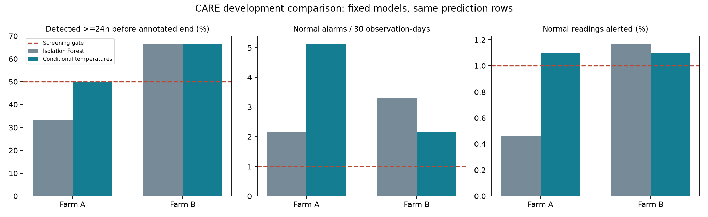

# CARE condition-aware model: results and decision

29 October 2026. Related issue #21.

**Recommendation: do not select CARE as the project's primary dataset on the
current evidence. Retain the files and results, but stop this two-model screening
exercise without promoting either model.** Both fixed configurations failed the
predeclared alarm limits. This is a practical non-adoption decision, not proof
that CARE is scientifically unsuitable or that no model can succeed.

The second experiment trained 37 independent multioutput Extra Trees regressors
to predict component temperatures from ambient temperature, wind, power and rotor
speed, including six-reading causal means. It alerts on persistent standardized
temperature residuals. Settings were frozen in
[the protocol](care-residual-protocol.md) before training; no post-result tuning.

| Metric | A: Isolation Forest | A: conditional temperatures | B: Isolation Forest | B: conditional temperatures |
|---|---:|---:|---:|---:|
| Detected >=24h before annotated end | 4/12 | 6/12 | 4/6 | 4/6 |
| Any within-interval detection | 4/12 | 8/12 | 4/6 | 4/6 |
| Normal alarm episodes | 13 | 31 | 26 | 17 |
| Episodes / 30 normal observation-days | 2.15 | 5.14 | 3.32 | 2.17 |
| Normal readings alerted | 0.46% | 1.10% | 1.17% | 1.10% |
| Normal files with alerts | 4/10 | 6/10 | 2/9 | 8/9 |
| Passed full screening gate | No | **No** | No | **No** |

Both farms now reach the 50% early-detection threshold, but neither satisfies
the <=1 alarm episode per 30 normal observation-days or <=1% alerted-normal-row
limits. These are our engineering screening assumptions, not approved operational
requirements. The zero-alarm reference has zero detections and zero alarms.



## Interpretation

Farm A improves aggregate detection but is not a strict improvement: v2 adds
early detections for events 10, 26, 42, 68 and 84, retains 40, and loses the early
detections for 0, 45 and 73. Event 73 is detected only 17.3 hours before annotated
end, and event 51 only six hours before end; neither meets the 24-hour rule.
Normal alarm burden more than doubles.

Farm B detects the same four cases (19, 27, 53, 77). It reduces total alarm
episodes, but distributes them across eight of nine normal files rather than two.
All four first in-interval detections occur in status 0, and none is an alert
already active at interval start. This supports detecting some abnormal behavior
during operation; it does not prove that the alarms predict physical failure.

**All lead times are relative to annotated anomaly ends.** Exact physical failure
timing remains unverified. Normal alarm rates are measured on curated files, not
a fleet-wide prospective deployment. Repeated turbines are correlated. The same
A/B cases have been examined in both experiments, so this is development evidence.

## Validation and resource use

- Completed all 37 models in 68.7 seconds. Selected columns only, one event file
  at a time, up to 12,000 fitting rows and two worker threads. Peak RAM unmeasured.
- Source SHA-256 hashes and prediction-row counts match v1 for every file.
  Identical observation-day denominators: A 181.0; B 234.85.
- Minimum valid prediction coverage: A 98.61%, B 99.92%; every file clears 80%.
  Context gaps reset rolling means and persistence. Invalid rows stay in the
  evaluation denominator and cannot trigger alerts.
- Chronological fit, residual-scaling, threshold-calibration and prediction
  boundaries verified for all 37 files. Temperature outcomes are never predictors;
  prediction status never enters fitting or scoring. Residual scaling is learned
  on a separate earlier calibration segment from threshold estimation.
- Five tests passed across both implementations, including future-data mutation,
  prefix invariance and gap behavior. A single-target array-shape error was found
  by synthetic tests and corrected before real-data training. Ruff passed; the
  comparison chart was visually inspected.
- The comparison changes model, feature set and calibration structure; it is not
  an isolated causal test of the regression algorithm. No hyperparameter search,
  late threshold change, removed control file or model ensemble was used.

Farm C remains performance-uninspected (metadata and quality already inspected).
No existing application model, primary dataset configuration or source file was
changed. Scope approval remains separate. A future CARE research effort would
need a new explicitly bounded objective and independent confirmation, rather than
repeatedly tuning these exposed cases until a favorable score appears.

## Reproduction and evidence

```powershell
.venv/Scripts/python.exe -m scripts.train_care_residual 'C:\Users\tmuny\Downloads\CARE_To_Compare\CARE_To_Compare' --output docs/results/care-residual-reproduction --models .local/care-residual-reproduction-models
```

The runner requires new output directories. Results are in
[summary.json](results/care-residual-v2/summary.json),
[events.csv](results/care-residual-v2/events.csv),
[comparison.csv](results/care-residual-v2/comparison.csv),
[turbines.csv](results/care-residual-v2/turbines.csv), and
[config.json](results/care-residual-v2/config.json).
The configuration records script/protocol hashes and library versions. Per-event
records retain source/model hashes. Trained models and timestamp-level scores are
ignored locally under `.local/care-residual-v2-models`.

Implementation: [training](../scripts/train_care_residual.py),
[reporting](../scripts/report_care_residual.py),
[tests](../tests/test_care_residual.py).
