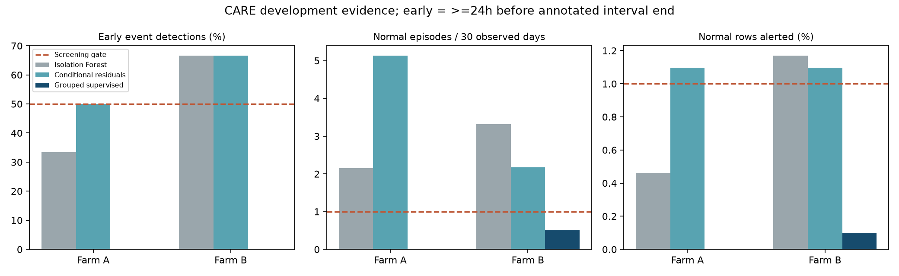

# CARE deeper research: supervised component trajectories

29 October 2026. Related issue #21. This investigation was explicitly authorized
after the earlier non-adoption recommendation. It does not erase earlier failures.

**Outcome: this deeper approach also fails. Do not promote it or pivot the project
on these results.** It learned the fitting examples but did not reliably transfer
to excluded turbines. The result strengthens the practical non-adoption decision
for the tested A/B setup; it does not establish that every CARE approach or the
untested Farm C must fail.

## Completed evaluation

| Metric | Farm A | Farm B |
|---|---:|---:|
| Anomaly cases detected >=24h before annotated end | **0/12** | **0/6** |
| Any within-interval detections | 0/12 | 0/6 |
| Normal alarm episodes | 0 | 4 |
| Normal episodes / 30 observed days | 0.00 | 0.51 |
| Normal prediction rows alerted | 0.00% | 0.10% |
| Minimum valid prediction coverage per file | 88.87% | 97.30% |
| Full screening gate | **Fail** | **Fail** |

Normal exposure remains 181.0 observed days in A and 234.85 in B. Six-hour feature
warm-up and gaps reduce valid coverage, but every file clears the fixed 80% gate;
invalid rows remain in the evaluation denominator. No difficult cases were removed.
Thresholds ranged from 0.90 to 0.975; none used the threshold-1 no-alarm fallback.
These classifier scores are not calibrated physical-failure probabilities.



The algorithm kept normal alarms within budget but failed the >=50% detection
requirement. Being quiet is not a successful warning system. In comparison, v2
detected 6/12 A and 4/6 B early cases but exceeded the alarm limits. No configuration
has simultaneously met the detection and alarm requirements.

## Fitting versus transfer

The post-fit diagnostic used equal file weighting and at most 500 eligible rows
per file. Fitting AUCs were 0.908–0.945 in A and 0.953–0.975 in B. On excluded
turbines with both classes, AUCs dropped to 0.314–0.547 in A and 0.047–0.668 in B.
An AUC near 0.5 means little discrimination; these are discrimination statistics,
not accuracy percentages. Three B turbines have only normal cases, so their
held-out AUCs are correctly left undefined rather than filled in.

This supports a specific finding: **the selected representation and classifier
can fit familiar examples, but their learned separation does not transfer well**.
It does not prove whether the underlying cause is failure-mode heterogeneity,
operating-condition shift, model limitations, limited independent examples, or
annotation uncertainty. Those remain hypotheses, not established diagnoses.

The 2,000 turbine-cluster resamples gave B's normal episode rate an empirical
95% percentile range of 0–1.64 per 30 days. All detection resamples are zero because
every observed detection is zero. **That degenerate bootstrap range is not proof
of zero population detection probability or zero uncertainty.** Likewise A's
zero-alarm bootstrap is not an operational zero-false-alarm guarantee. All resamples
had defined denominators. Only five and nine turbine clusters are available; the
intervals condition on fitted predictions and omit model-selection uncertainty.

## Decision

These experiments have not produced reliable early warning. Do not claim otherwise
from fitting scores or low alarm counts. Keep CARE and the reproducible evidence,
but do not make the proposed project pivot on the current A/B results. The original
alarm limits are provisional engineering assumptions, not supervisor-approved
requirements, and the analysis does not exhaust every possible research approach.

The new result answers the user's central question more precisely: making a model
fit is possible; making its warnings dependable on different machines remains
unresolved. A further effort would need a new, bounded hypothesis and fresh
confirmation data, rather than a search for a flattering score on these same cases.

## Research question and intervention

The first two models learned normal behavior but did not learn the difference
between a developing fault and a normal operating change from labelled examples.
The second model also collapsed all components into one maximum residual. This
study tests whether component-specific trajectories and supervised transfer help.

The research intervention combines:

1. **Physical conditioning:** reuse the frozen expected-temperature models,
   fitted on each file's earlier normal history. Express residuals relative to
   their earlier calibration bias and robust scale.
2. **Temporal structure:** preserve signed residuals for every component, plus
   causal one-hour and six-hour reading-window means and departures from the
   longer mean. Six readings span 50 minutes; 36 span 350 minutes. Windows reset
   on cadence breaks and require complete data. No future interpolation.
3. **Supervised contrast:** learn from labelled early anomaly intervals versus
   normal control files, using a regularized shallow gradient-boosted classifier.
   Exclude the final 24 hours of anomaly intervals from positive training examples.
4. **Dependence-aware sampling:** cap each file at 500 evenly spaced examples;
   give each class equal total weight and each file equal weight within its class.
5. **Nested validation:** exclude every file of the evaluated turbine from both
   classifier fitting and threshold selection. Set thresholds using inner held-out
   normal turbines, with the same alarm budget. Report every evaluated case.
6. **Uncertainty:** resample entire turbines, rather than pretending thousands of
   neighboring readings are independent trials. Use 2,000 fixed-seed resamples.

There are five outer turbines in A and nine in B. Normal-history adaptation on the
evaluated turbine remains allowed, as in v2; only label transfer is turbine-held-out.
This is not zero-shot inference or a global calendar backtest. Dates are anonymized,
and all A/B outcomes were already development-exposed. Farm C is not evaluated.

The [frozen protocol](care-supervised-protocol.md) defines the single configuration,
threshold candidates and stopping rule. Thresholds use only normal calibration
cases, not the faults being evaluated. Inner models are reused for identical
excluded-turbine pairs. No hyperparameter search or outcome-driven retuning occurs.

Completed 46 inner two-turbine-exclusion fits and 14 outer fits (60 classifiers).
Verified all 14 fitting/calibration exclusion lists, all 37 source-file identities
and unchanged prediction-row counts against v2. Eight causal/grouping tests passed;
Ruff passed. The chart was visually inspected. Sampled process working memory was
about 250 MB; this was not a peak-memory benchmark. Final classifiers, thresholds
and hashes are retained locally; intermediate inner models are reproducible from
the frozen code and seed, with calibration threshold audits saved.

## Why threshold adjustment alone was unlikely to solve v1/v2

Descriptive file-level ranking diagnostics use the 90th percentile of score divided
by the file's threshold: inside annotated intervals for anomaly files, across the
prediction section for normal files. These are post-result descriptive comparisons,
not a new deployable detector: interval membership is unavailable online.

| Score representation | A: descriptive file AUC | B: descriptive file AUC |
|---|---:|---:|
| v1 Isolation Forest | 0.533 | 0.426 |
| v2 maximum conditional residual | 0.642 | 0.463 |

An AUC around 0.5 indicates overlapping rankings for this summary. These figures
suggest weak separation in the aggregate scores, especially B. They do not prove
absence of signal in individual components or provide an upper bound for every
possible temporal detector. Different durations and correlated turbines remain
limitations. No threshold was selected using these diagnostics.

## Label meaning

The benchmark documentation describes the annotated interval as estimated abnormal
behavior leading toward a fault, potentially while the turbine is still operating.
It distinguishes these labels from operating-status codes. Thus early detection
inside these intervals is a legitimate research task; we should not describe CARE
as intrinsically inappropriate merely because our models failed.
[CARE documentation](https://aefdi.github.io/EnergyFaultDetector/care2compare_faq.html).

Our numerical lead remains relative to annotated interval end. An exact physical
failure timestamp and practical intervention requirement have not been independently
verified for each case. Passing the research screen would not itself establish an
operational failure forecast.

## Evidence and reproducibility

Implementation: [experiment](../scripts/research_care_supervised.py),
[earlier-score diagnostics](../scripts/diagnose_care_scores.py),
[transfer diagnostics](../scripts/diagnose_care_transfer.py),
[report](../scripts/report_care_supervised.py),
[tests](../tests/test_care_supervised.py).

```powershell
.venv/Scripts/python.exe -m scripts.research_care_supervised 'C:\Users\tmuny\Downloads\CARE_To_Compare\CARE_To_Compare' --output docs/results/care-supervised-reproduction --models .local/care-supervised-reproduction-models
```

Requires the frozen v2 models in `.local/care-residual-v2-models` and their aggregate
hash records. The runner verifies source and upstream model hashes, and refuses
existing output directories. Model and timestamp-score artifacts remain ignored
locally. All aggregate evidence is in `docs/results/care-supervised-v3/`.
This includes `summary.json`, `events.csv`, `folds.json`, `turbines.csv`,
`earlier-score-diagnostics.csv`, and `fit-versus-transfer.csv`. The ignored
diagnostic feature cache is tied to upstream model-record and feature-code hashes;
it reconstructs the same experiment, not a refreshed external dataset.
